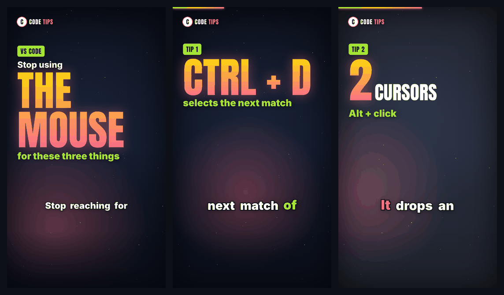

# remotion-shorts

A skill for coding agents (it follows the `SKILL.md` format) that turns a topic into a **vertical video ready to review**: your agent writes a `script.json`, validates it, shows you preview frames, then renders a 1080x1920 MP4 with [Remotion](https://www.remotion.dev).



It is not a "how to use Remotion" guide: it ships a small, tested engine, so the agent has nothing to scaffold.

- Hook on screen from frame 0, first background cut at 1.3 s
- Word-by-word karaoke captions (from your word timings or an ElevenLabs alignment; estimated without them)
- Animated titles and counters, progress bar, ending that loops back to the hook
- `--dry-run` validation with readable errors, PNG previews before any full render
- The engine itself uploads nothing, fetches no stock media and posts nothing (installing it downloads npm packages, and the first render downloads a headless browser)

## Install

With the [skills CLI](https://github.com/vercel-labs/skills), using the address of this repository:

```
npx skills add <owner>/remotion-shorts
```

Or copy this folder into your agent's skills folder as `remotion-shorts`. Then, once:

```
cd <skill folder>/scripts
npm install
npm test
```

Node 22.6 or later for the engine. The skills CLI itself asks for **Node 22.20 or later** (checked in version 1.9.0); copying the folder by hand has no such requirement.

**Reinstalling or updating deletes the installed folder and copies it again.** Anything you added inside it is lost: the engine's `.env`, rendered videos in `scripts/sortie/`, video folders, clips and music. Keep your video folders in your own project, and set the `DOSSIER_SORTIE` environment variable (not the line in the engine's `.env`) so that renders are written outside the skill.

## Use

Ask your agent: *"Make a 35 s Short about three VS Code shortcuts."*

Or run the engine yourself on the example:

```
node --experimental-strip-types rendu.ts exemples/demo-shortcuts --dry-run
node --experimental-strip-types rendu.ts exemples/demo-shortcuts --apercu 0,12,19
node --experimental-strip-types rendu.ts exemples/demo-shortcuts
```

On Windows PowerShell you can use `.\rendu.cmd` instead of the first part.

## What it does not do

- No voice generation: you bring `voix.mp3`. Without it the video is silent.
- No stock footage and no music: without clips the background is a simple animated gradient.
- Vertical only, one look (logo text and colours are customisable).
- The JSON field names, the engine's console messages and the engine's own README are in French. The skill instructions are in English and tell the agent how to handle it. The field reference is in [references/script-schema.md](references/script-schema.md).

## Licenses: read this before using it for work

The files in this repository are under the [MIT License](LICENSE). **Remotion is not MIT.** Its own license is free for individuals and for organisations of up to 3 people (and for some other cases described there); larger companies need a paid company license, and automated rendering has its own plan. Check [remotion.dev/docs/license](https://www.remotion.dev/docs/license) for your situation. Fonts (Anton, Inter) are installed from npm under their own licenses.

## Feedback

Open an issue with what you tried to make and what got in the way.
